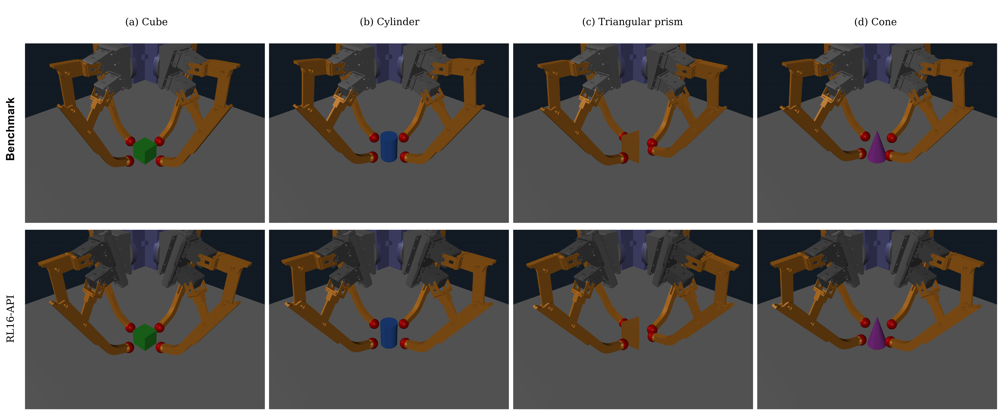
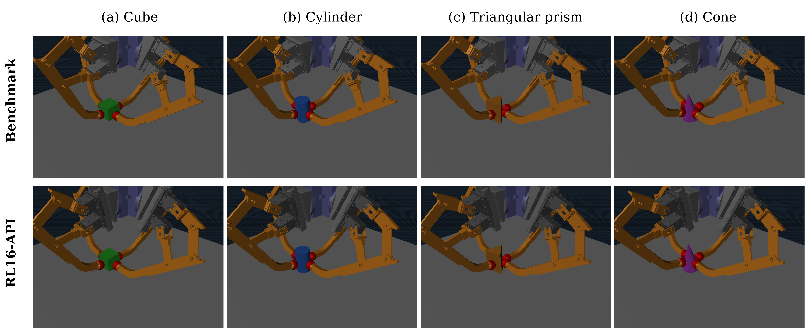
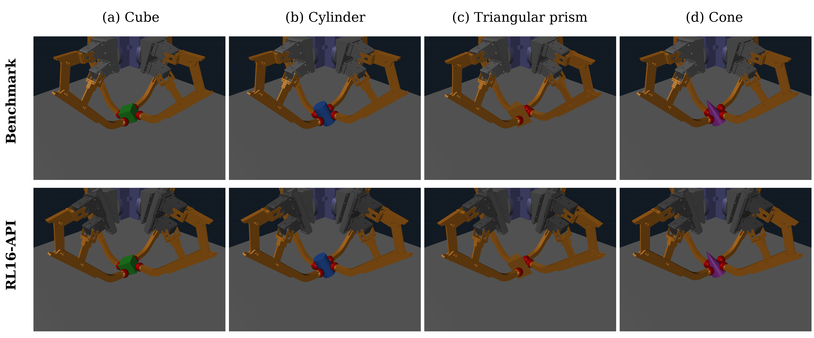
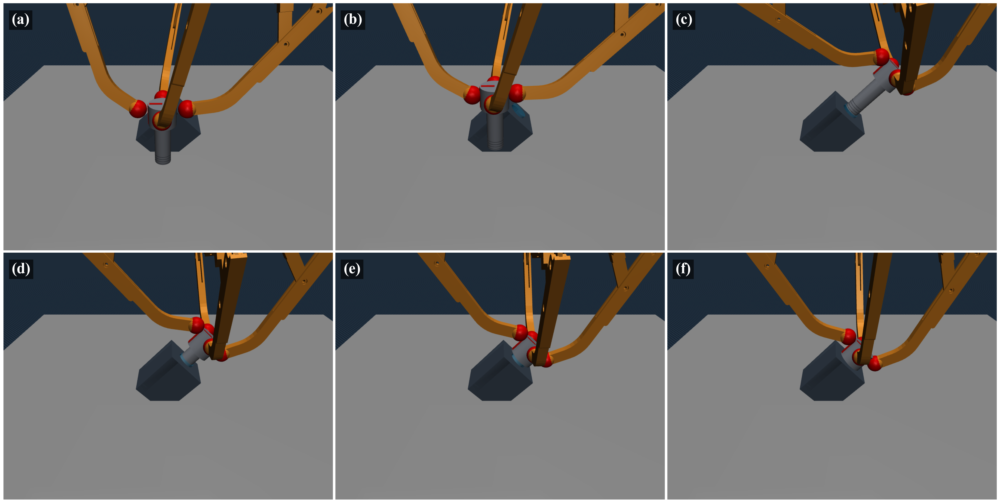

# In-Hand Manipulation Project

四指机械手手内操作（In-Hand Manipulation）研究项目的源代码归档。项目基于 MuJoCo 仿真，涵盖四种机械手结构的解析运动学 / 逆运动学（IK）、数值工作空间分析，以及 Diffusion Policy + TQC 残差强化学习的训练与评估代码，覆盖物体的平移、旋转与螺旋装配等操作任务。

## 仓库结构

| 目录 | 说明 |
| --- | --- |
| `Benchmark/` | 基准机械手（原 Gripper3）：12 个主动执行器，每指三路旋转。解析闭链运动学、IK 控制、数值工作空间扫描、准静态载荷计算，含 CAD 源模型与仿真网格 |
| `RL16-PA/` | 16 执行器机械手（原 Gripper4）：每指四路主动坐标，模型层次 root → linear → armbase，平移副位于旋转副之前 |
| `RL16-AP/` | 16 执行器机械手（原 Gripper5）：每指四路主动坐标，先绕局部 x 轴旋转，再沿旋转后的局部 z 轴平移 |
| `RL16-API/` | 16 执行器机械手（原 Gripper6）：armbase → linear → fingers，闭链 IK 同时检查被动关节、冗余直线坐标与执行器限位，含旋转工作空间与载荷计算 |
| `IK-residual/` | 解析 IK + TQC 残差强化学习（原 G3G6）：Benchmark（12 通道）与 RL16-API（16 通道）的课程式训练、安全预热训练与多维度策略评估，两手分别训练、不共享动作输出层 |
| `Diffusion/` | RL16-API 螺旋装配任务（原 SCREW）：专家示范生成、Diffusion Policy、TQC 残差训练与任务评估；含 Apple Silicon MPS/CPU 本机链路与 Linux CUDA + MJWarp HPC 训练链路 |
| `Diffusion_FutureWork/` | YCB GRAB 抓取研究归档：Benchmark 与 RL16-API 两套机械手对应的 Diffusion/RL 模型定义、训练与评估代码，以及 YCB 物体模型 |
| `RL_env/` | 共享 Python 环境与启动器：`build.sh` 构建、`run.sh` 统一启动、`doctor.py` 环境检查、依赖声明；安装好的虚拟环境不纳入版本管理 |

各目录下的 README 包含更详细的目录职责、运行命令与契约说明。

## 环境与依赖

所有目录共用根目录 `RL_env/` 管理的 Python 环境，目录内部不再单独创建虚拟环境。

| 用途 | 主要依赖 |
| --- | --- |
| 本机 MPS/CPU（macOS arm64，CPython 3.11） | MuJoCo 3.7.0、Torch 2.11.0、NumPy 2.4.4、Gymnasium 1.2.3、SB3/TQC 2.8.0 |
| HPC / MJWarp core（Linux CUDA） | MuJoCo 3.10.0、mujoco-warp 3.10.0.3、Warp 1.14.0、Torch 2.7.1 CUDA 12.8 |

## 快速开始

```bash
# Linux / HPC 上先构建环境（macOS 本机环境已随归档配置）
bash RL_env/build.sh --profile local

# 统一启动入口：在仓库根目录执行任意脚本
bash RL_env/run.sh local Benchmark/translation/T3_kinematics.py --help
bash RL_env/run.sh local RL16-API/translation/T6_IKcontrol.py --no-render

# 数值工作空间扫描示例
bash RL_env/run.sh local RL16-AP/translation/T5_workspace.py \
  --z-min 0.4 --z-max 0.4 --theta-step-deg 90 \
  --r-step 0.02 --workers 1
```

`--no-render` 用于终端和服务器；macOS 的 MuJoCo 交互窗口由共享环境中的 `mjpython` 启动。控制目标采用 `z r theta`，长度单位为米、角度默认为度。

## 仿真演示

<p align="center">
  
  <br>
  <em>Matched initial positions of the Benchmark and RL16-API grippers with all four regular objects in MuJoCo.</em>
</p>

<p align="center">
  
  <br>
  
  <br>
  <em>MuJoCo task endpoints for the Benchmark and RL16-API grippers with all four regular objects. Top: pure-translation S-path endpoints. Bottom: local-XYZ (+15, −21, +30)° rotation endpoints. <a href="https://youtube.com/shorts/BwXKaWDFlWQ">Supplementary video demonstration</a> (from 0:00 to 1:25).</em>
</p>

<p align="center">
  
  <br>
  <em>Motion demonstration of the Diffusion–IK–residual controller: (a) close, tick 107; (b) lift, tick 163; (c) aligned approach, tick 561; (d) insert, tick 897; (e) engage, tick 997; and (f) final hold, tick 3155. The camera plane is parallel to the socket side and inclined by 30° to the table. <a href="https://youtube.com/shorts/BwXKaWDFlWQ">Supplementary video demonstration</a> (from 1:25 to 2:08).</em>
</p>

## 说明

- 本仓库只包含源代码、训练配置、仿真 XML 与 STL/CAD 资产；不包含训练权重、示范数据、运行日志与论文文档。
- MPS 本机链路与 HPC/MJWarp 链路具有各自的环境与运行契约，两条链路的检查点不可互换。
